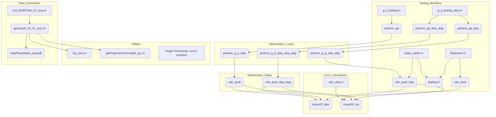

# Plan: MATLAB to Python Light-Field Correction Algorithm Translation

**Overall Goal:** Translate the MATLAB-based light-field correction algorithm to Python, ensuring functionality matches MATLAB, with testable checkpoints. The initial focus is on direct translation, with Pythonic improvements and further algorithm development planned for later stages in Python after robust alignment. Minor numerical differences are acceptable if the scientific outcome is preserved.

## Phase 1: Foundation & Basic Utilities

- [ ] **Environment Setup:**
    - [ ] Create a Python environment (e.g., using Conda or venv).
    - [ ] Install core libraries:
        - [ ] `numpy`: For numerical operations (CPU).
        - [ ] `scipy`: For `.mat` file I/O (`scipy.io.loadmat`, `scipy.io.savemat`), interpolation (`scipy.interpolate`), signal processing (`scipy.signal`, specifically `convolve2d`).
        - [ ] `matplotlib`: For 2D plotting.
        - [ ] `cupy`: For GPU-accelerated array computations (NVIDIA GPUs).
        - [ ] `scikit-image`: For image processing utilities like `skimage.transform.resize` (for `imresize`).
- [ ] **Project Structure:**
    - [ ] Establish a clear Python project directory (e.g., `python_lf_correction`) with subdirectories for source code (`src`), tests (`tests`), data (`data`), and scripts (`scripts`).
- [ ] **Basic Utility Translation:**
    - [ ] **Data I/O:**
        - [ ] Python functions to load data from `.mat` files (e.g., `example_LF.mat`, `LF_parabolic.mat`, `LF_sinus.mat`). These will serve as key test inputs.
    - [ ] **Visualization Wrappers:**
        - [ ] Translate `displayLF.m`, `displayLF_real.m`, and `show_LF_grid.m` to Python/Matplotlib.
- [ ] **Initial GPU Setup:**
    - [ ] Test CuPy for basic GPU array operations.
    - [ ] Helper functions for CPU (NumPy) <-> GPU (CuPy) data transfers.
- [ ] **Checkpoint & Testing Strategy (Phase 1):**
    - [ ] **Goal:** Load MATLAB data (especially `LF_parabolic.mat`, `LF_sinus.mat`), perform basic manipulations, visualize in Python matching MATLAB plots.
    - [ ] **Testing:** Visual comparison, test data transfers.

## Phase 2: Core Signal Processing & Simulation Components

- [ ] **Convolution & Propagation:**
    - [ ] Translate `frq_conv.m` using NumPy/SciPy FFTs.
    - [ ] Translate `getPropConvKerFreq3D_cyc.m`.
    - [ ] Handle `conv2` calls (from Image Processing Toolbox) using `scipy.signal.convolve2d`, ensuring correct parameter mapping (e.g., `shape`).
- [ ] **Interpolation & Resizing:**
    - [ ] Translate `interp2D_bkw.m` and `interp2D_frw.m` using `scipy.interpolate` functions.
    - [ ] Handle `imresize` calls (from Image Processing Toolbox) using `skimage.transform.resize` or `scipy.ndimage.zoom`, matching interpolation methods and anti-aliasing.
- [ ] **Correlation:** Translate `xcorr2_fft.m`.
- [ ] **Simulation/Data Generation Components (as needed for testing):**
    - [ ] Translate `smpPhaseMask_GaussB.m`.
    - [ ] Translate `getLayerd_To_LF_and_hr.m`.
    - [ ] Translate `LFsin.m`.
- [ ] **Checkpoint & Testing Strategy (Phase 2):**
    - [ ] **Goal:** Core signal processing functions numerically validated.
    - [ ] **Testing:** Unit tests for each function. Compare Python (NumPy/CuPy) outputs against MATLAB outputs using `numpy.testing.assert_allclose` with appropriate tolerance, using data from `LF_parabolic.mat` and `LF_sinus.mat` as inputs where applicable.

## Phase 3: Forward & Backward Light-Field Models

- [ ] **Displacement Calculation:** Translate `calc_disp.m`.
- [ ] **Backward Projection/Correction:** Translate `calc_back.m`.
- [ ] **Checkpoint & Testing Strategy (Phase 3):**
    - [ ] **Goal:** Main light-field transformation models validated.
    - [ ] **Testing:** Compare output arrays (displacement fields, corrected LFs) from Python against MATLAB versions using shared input data (e.g., from `LF_parabolic.mat`). Visualize results.

## Phase 4: Gradient and Cost Functions

- [ ] **Gradient Calculations:** Translate `calc_grad.m`, `calc_grad_disp.m`, `calc_grad_disp_diag.m`.
- [ ] **Numerical Gradient (for testing):** Translate `calc_num_grad.m`.
- [ ] **Cost Functions:** Translate `naive_cost.m` and ensure cost values from gradient functions are consistent.
- [ ] **Checkpoint & Testing Strategy (Phase 4):**
    - [ ] **Goal:** Gradient and cost calculations numerically accurate.
    - [ ] **Testing:** Compare Python outputs with MATLAB. Use translated `calc_num_grad` (Python) to verify analytical gradients in Python.

## Phase 5: Optimization Algorithms

- [ ] **Optimization Step Functions:** Translate `perform_g_d_step.m`, `perform_g_d_step_disp.m`, `perform_g_d_step_disp_diag.m`.
- [ ] **Main Optimization Loops (Direct Translation Focus):** Translate `perform_gd.m`, `perform_gd_disp.m`, `perform_gd_disp_diag.m`, `adam_optim.m`.
- [ ] **Initialization:** Translate `initialize_mask.m`.
- [ ] **Checkpoint & Testing Strategy (Phase 5):**
    - [ ] **Goal:** Optimization routines run and produce comparable results/behavior to MATLAB.
    - [ ] **Testing:** Use test cases from MATLAB (e.g., from `LF_parabolic.mat`, `LF_sinus.mat` or by saving intermediate MATLAB states). Compare cost histories and final optimized masks.

## Phase 6: High-Level Scripts, Integration, and Robust Alignment

- [ ] **Testing/Driver Script Translation:** Translate `Backward.m`, `grad_testing.m`, `g_d_testing.m`, `g_d_testing_disp.m`, etc.
- [ ] **Full Workflow Validation:** Run complete workflows. Compare final outputs and scientific outcomes with MATLAB.
- [ ] **Robust Alignment:** Focus on ensuring the Python version faithfully replicates the MATLAB algorithm's behavior and outputs (within acceptable numerical tolerances) using the provided test `.mat` files.
- [ ] **Checkpoint & Testing Strategy (Phase 6):**
    - [ ] **Goal:** Achieve robust alignment with MATLAB code. The Python version is a reliable functional equivalent.
    - [ ] **Testing:** End-to-end tests.

## Phase 7: Further Python Development (Post-Alignment)

- [ ] **Algorithm Completion & Enhancement:** Proceed with further algorithmic development and completion in Python as planned.
- [ ] **Pythonic Refinements (Optional):** Review and refactor code for Python best practices, improved readability, and potentially leveraging more advanced features of Python libraries if beneficial.

## General Considerations (Reiteration):

- [ ] **Version Control (Git).**
- [ ] **MATLAB vs. Python Idioms:** 1-based vs. 0-based indexing, array operations, slicing, broadcasting, script/function scope.
- [ ] **GPU Handling (CuPy):** Explicit data movement, use CuPy equivalents for NumPy functions.
- [ ] **Debugging & Documentation.**
- [ ] **Testing Rigor:** `numpy.testing.assert_allclose` with appropriate tolerances.

## Mermaid Diagram: Phased Approach

```mermaid
graph TD
    P0[Project Setup: Python Env, Libs (NumPy, SciPy, Matplotlib, CuPy, Scikit-image), Structure, Git] --> P1[Phase 1: Basic Utilities & Data I/O];
    P1 --> P1_Test[Test: Load & Visualize MATLAB Data (LF_parabolic.mat, LF_sinus.mat)];
    P1_Test --> P2[Phase 2: Core Signal Processing (incl. conv2, imresize mapping)];
    P2 --> P2_Test[Test: Numerical Validation against MATLAB using test .mat files (CPU/GPU)];
    P2_Test --> P3[Phase 3: Forward & Backward Models];
    P3 --> P3_Test[Test: Compare Model Outputs with MATLAB using test .mat files];
    P3_Test --> P4[Phase 4: Gradient & Cost Functions];
    P4 --> P4_Test[Test: Validate Gradients (Analytical vs Numerical) & Costs against MATLAB];
    P4_Test --> P5[Phase 5: Optimization Algorithms (Direct Translation)];
    P5 --> P5_Test[Test: Compare Optimization Behavior & Results with MATLAB];
    P5_Test --> P6[Phase 6: High-Level Scripts, Integration & Robust Alignment];
    P6 --> P6_Test[Test: End-to-End Workflow Validation for Robust Alignment];
    P6_Test --> P7[Phase 7: Further Algorithm Development & Pythonic Refinement in Python];
    P7 --> P_Final[Final Python Codebase for Ongoing Research];

    classDef phase fill:#lightgrey,stroke:#333,stroke-width:2px;
    classDef test fill:#e6ffe6,stroke:#333,stroke-width:1px;
    class P0,P1,P2,P3,P4,P5,P6,P7,P_Final phase;
    class P1_Test,P2_Test,P3_Test,P4_Test,P5_Test,P6_Test test;
```

## Mermaid Diagram: Conceptual Module Dependencies (Simplified)

